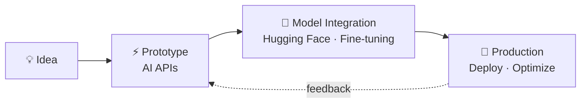

<div align="center">

<a href="https://github.com/GabrielJung0727/GabrielJung0727/blob/main/README.md"></a>
<a href="https://github.com/GabrielJung0727/GabrielJung0727/blob/main/README_ko.md"></a>
<a href="https://github.com/GabrielJung0727/GabrielJung0727/blob/main/README_en_gb.md"></a>


<a href="https://git.io/typing-svg"></a>

<p>
  <a href="mailto:jaewonjung1004@gmail.com"></a>
  <a href="https://www.linkedin.com/in/gabriel-jung-76a074356"></a>
  
</p>

</div>

---

### 👋 About

```python
class GabrielJung:
    role      = "AI Full-Stack Engineer"
    brand     = "DoubleJ"
    work      = ["Public Institution", "Freelance / Outsourcing"]
    focus     = ["NLP", "Applied AI Systems", "Real-time Prediction"]
    loop      = "idea → prototype → model → production"

    def build(self, idea):
        return self.deploy(self.integrate_model(self.prototype(idea)))
```

- 🏛 Currently working at a **public institution**
- 💼 Running a **freelance development** service — handling projects from planning to deployment
- 🧠 Building **end-to-end** — from AI model experiments to production services
- 🔧 Experienced in data pipelines · ML modeling · real-time prediction systems
- 🚀 Planning, building, and launching multiple products in parallel

---

### 🛠 Tech Stack

<div align="center">

**AI / ML**<br/>


**Frontend**<br/>


**Backend / Infra**<br/>


</div>

---

### 🚀 Featured Projects

#### 🤖 AI Dev Tooling

| Project | Description | Tags |
|:--|:--|:--|
| **[harnesslock](https://github.com/GabrielJung0727/harnesslock)** | Vendor-neutral lockfile & drift detector for AI coding agents (Claude Code, Codex, Cursor). 100% static, zero secrets stored. | `AI Agents` `DevTools` `Static Analysis` |

#### ✈️ Aviation & Safety-Critical Systems

| Project | Description | Tags |
|:--|:--|:--|
| **[Avionics Verification Workbench](https://github.com/GabrielJung0727/avionics-verification-workbench)** | Certification-aligned V&V platform with a governed AI assurance layer for civil avionics software — governed datasets, frozen learned components, and a deterministic safety shell. | `V&V` `AI Assurance` `Safety-Critical` |
| **[Airport Delay Lab](https://github.com/GabrielJung0727/Airport-Delay-Congestion-Analytics-with-Machine-Learning)** | Full-stack platform that analyzes and predicts airport congestion and delay risk, served through a dashboard and a route advisor. | `ML` `Forecasting` `Full-Stack` |
| **[Airport Flight & Gate Ops](https://github.com/GabrielJung0727/Airport-Flight-Gate-Operations-Management-System)** | Airport operations system managing flights, gates, assignments, flight events, and reports in a single web UI. | `Web App` `CRUD` `Dashboard` |

#### 👁 Computer Vision & ML

| Project | Description | Tags |
|:--|:--|:--|
| **[Multi-Aircraft CLIP Representation](https://github.com/GabrielJung0727/multi-aircraft-clip-representation)** | Aircraft representation learning across PlanesNet, HRPlanes v2, and FGVC Aircraft using CLIP, rotation-oriented augmentation, U-Net transfer, DiT, and BERT. | `CLIP` `DiT` `U-Net` `Research` |
| **[Marker-Aware OCR](https://github.com/GabrielJung0727/marker-aware-ocr)** | YOLO detection + OCR ensemble + Ollama post-processing pipeline for handwritten and marker-heavy documents. | `YOLO` `OCR` `Ollama` |

#### 🎧 Audio Systems

| Project | Description | Tags |
|:--|:--|:--|
| **[Music Program](https://github.com/GabrielJung0727/music-program)** | Hi-fi audio lounge — a distributed audio system built on a Core / Control / Output architecture. Listen alone or together, as one sound. | `Distributed` `Audio` `Realtime` |

👉 See all projects in **[Repositories](https://github.com/GabrielJung0727?tab=repositories)**

---

### ⚙️ Workflow



---

### 📬 Contact

For freelance and collaboration inquiries, please reach out **by email only**.

**✉️ [jaewonjung1004@gmail.com](mailto:jaewonjung1004@gmail.com)**

---

### 📊 GitHub Stats

<div align="center">


</div>


