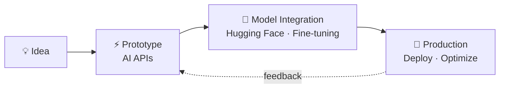

<div align="center">


<a href="https://git.io/typing-svg"></a>

<p>
  <a href="mailto:jaewonjung1004@gmail.com"></a>
  <a href="https://www.linkedin.com/in/gabriel-jung-76a074356"></a>
  
</p>

</div>

---

### 👋 About

```python
class GabrielJung:
    role      = "AI Full-Stack Engineer"
    brand     = "DoubleJ"
    work      = ["Public Institution", "Freelance / Outsourcing"]
    focus     = ["NLP", "Applied AI Systems", "Real-time Prediction"]
    loop      = "idea → prototype → model → production"

    def build(self, idea):
        return self.deploy(self.integrate_model(self.prototype(idea)))
```

- 🏛 현재 **공공기관**에서 근무 중
- 💼 **외주 개발** 서비스 운영 중 — 기획부터 배포까지 맡아서 진행합니다
- 🧠 AI 모델 실험부터 서비스 배포까지 **end-to-end**로 만듭니다
- 🔧 데이터 파이프라인 · ML 모델링 · 실시간 예측 시스템 경험
- 🚀 여러 프로덕트를 동시에 기획 · 개발 · 런칭 중

---

### 🛠 Tech Stack

<div align="center">

**AI / ML**<br/>


**Frontend**<br/>


**Backend / Infra**<br/>


</div>

---

### 🚀 Featured Projects

| Project | Description | Stack |
|:--|:--|:--|
| **[SkyOps Intelligence](LINK)** | 실시간 AI 보조 항공 관제 시스템 | `Python` `ML` `Realtime` |
| **[MODAM](LINK)** | 파크골프 클럽 운영 SaaS | `Next.js` `PostgreSQL` |
| **[AI Document Parser](LINK)** | monday.com B2B 마켓플레이스 앱 | `TypeScript` `LLM` |

👉 전체 프로젝트는 **[Repositories](https://github.com/GabrielJung0727?tab=repositories)** 에서

---

### ⚙️ Workflow



---

### 📬 Contact

외주 · 협업 문의는 **이메일로만** 받습니다.

**✉️ [jaewonjung1004@gmail.com](mailto:jaewonjung1004@gmail.com)**

---

### 📊 GitHub Stats

<div align="center">


</div>


