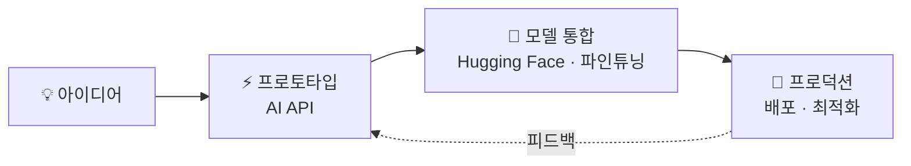

<div align="center">

<a href="https://github.com/GabrielJung0727/GabrielJung0727/blob/main/README.md"></a>
<a href="https://github.com/GabrielJung0727/GabrielJung0727/blob/main/README_ko.md"></a>
<a href="https://github.com/GabrielJung0727/GabrielJung0727/blob/main/README_en_gb.md"></a>


<a href="https://git.io/typing-svg"></a>

<p>
  <a href="mailto:jaewonjung1004@gmail.com"></a>
  <a href="https://www.linkedin.com/in/gabriel-jung-76a074356"></a>
  
</p>

</div>

---

### 👋 소개

```python
class GabrielJung:
    role      = "AI Full-Stack Engineer"
    brand     = "DoubleJ"
    work      = ["Public Institution", "Freelance / Outsourcing"]
    focus     = ["NLP", "Applied AI Systems", "Real-time Prediction"]
    loop      = "idea → prototype → model → production"

    def build(self, idea):
        return self.deploy(self.integrate_model(self.prototype(idea)))
```

- 🏛 현재 **공공기관**에서 근무 중입니다
- 💼 **외주 개발** 서비스를 운영하며, 기획부터 배포까지 맡아서 진행합니다
- 🧠 AI 모델 실험부터 실서비스까지 **엔드투엔드**로 만듭니다
- 🔧 데이터 파이프라인 · ML 모델링 · 실시간 예측 시스템 경험
- 🚀 여러 프로덕트를 동시에 기획 · 개발 · 런칭하고 있습니다

---

### 🛠 기술 스택

<div align="center">

**AI / ML**<br/>


**Frontend**<br/>


**Backend / Infra**<br/>


</div>

---

### 🚀 주요 프로젝트

#### 🤖 AI 개발 도구

| 프로젝트 | 설명 | 태그 |
|:--|:--|:--|
| **[harnesslock](https://github.com/GabrielJung0727/harnesslock)** | AI 코딩 에이전트(Claude Code, Codex, Cursor)를 위한 벤더 중립 락파일 & 드리프트 감지 도구. 100% 정적 분석, 시크릿 저장 없음. | `AI Agents` `DevTools` `Static Analysis` |

#### ✈️ 항공 · 안전 필수 시스템

| 프로젝트 | 설명 | 태그 |
|:--|:--|:--|
| **[Avionics Verification Workbench](https://github.com/GabrielJung0727/avionics-verification-workbench)** | 민간 항공전자 소프트웨어를 위한 인증 기준 정렬 V&V 플랫폼. 관리된 데이터셋, 동결된 학습 컴포넌트, 결정론적 안전 셸로 구성된 AI 보증 계층을 제공합니다. | `V&V` `AI Assurance` `Safety-Critical` |
| **[Airport Delay Lab](https://github.com/GabrielJung0727/Airport-Delay-Congestion-Analytics-with-Machine-Learning)** | 공항별 혼잡도와 지연 가능성을 분석·예측해 대시보드와 길찾기 어드바이저로 제공하는 풀스택 프로젝트. | `ML` `Forecasting` `Full-Stack` |
| **[Airport Flight & Gate Ops](https://github.com/GabrielJung0727/Airport-Flight-Gate-Operations-Management-System)** | 항공편 · 게이트 · 배정 · 운항 이벤트 · 리포트를 하나의 웹에서 관리하는 공항 운영 시스템. | `Web App` `CRUD` `Dashboard` |

#### 👁 컴퓨터 비전 & ML

| 프로젝트 | 설명 | 태그 |
|:--|:--|:--|
| **[Multi-Aircraft CLIP Representation](https://github.com/GabrielJung0727/multi-aircraft-clip-representation)** | PlanesNet · HRPlanes v2 · FGVC Aircraft를 통합한 항공기 표현 학습 실험. CLIP, 회전 기반 증강, U-Net 전이, DiT, BERT 활용. | `CLIP` `DiT` `U-Net` `Research` |
| **[Marker-Aware OCR](https://github.com/GabrielJung0727/marker-aware-ocr)** | 손글씨·마커가 많은 문서를 위한 YOLO 검출 + OCR 앙상블 + Ollama 후처리 파이프라인. | `YOLO` `OCR` `Ollama` |

#### 🎧 오디오 시스템

| 프로젝트 | 설명 | 태그 |
|:--|:--|:--|
| **[Music Program](https://github.com/GabrielJung0727/music-program)** | 하이파이 오디오 라운지. Core / Control / Output 3단 구조의 분산 오디오 시스템. 혼자서 듣든 같이 듣든, 하나의 소리로 최고의 경험을. | `Distributed` `Audio` `Realtime` |

👉 전체 프로젝트는 **[Repositories](https://github.com/GabrielJung0727?tab=repositories)** 에서 볼 수 있습니다

---

### ⚙️ 작업 방식



---

### 📬 연락처

외주 · 협업 문의는 **이메일로만** 받습니다.

**✉️ [jaewonjung1004@gmail.com](mailto:jaewonjung1004@gmail.com)**

---

### 📊 GitHub 통계

<div align="center">


<picture>
  <source media="(prefers-color-scheme: dark)" srcset="https://raw.githubusercontent.com/GabrielJung0727/GabrielJung0727/output/github-snake-dark.svg" />
  <source media="(prefers-color-scheme: light)" srcset="https://raw.githubusercontent.com/GabrielJung0727/GabrielJung0727/output/github-snake.svg" />
  
</picture>

</div>


